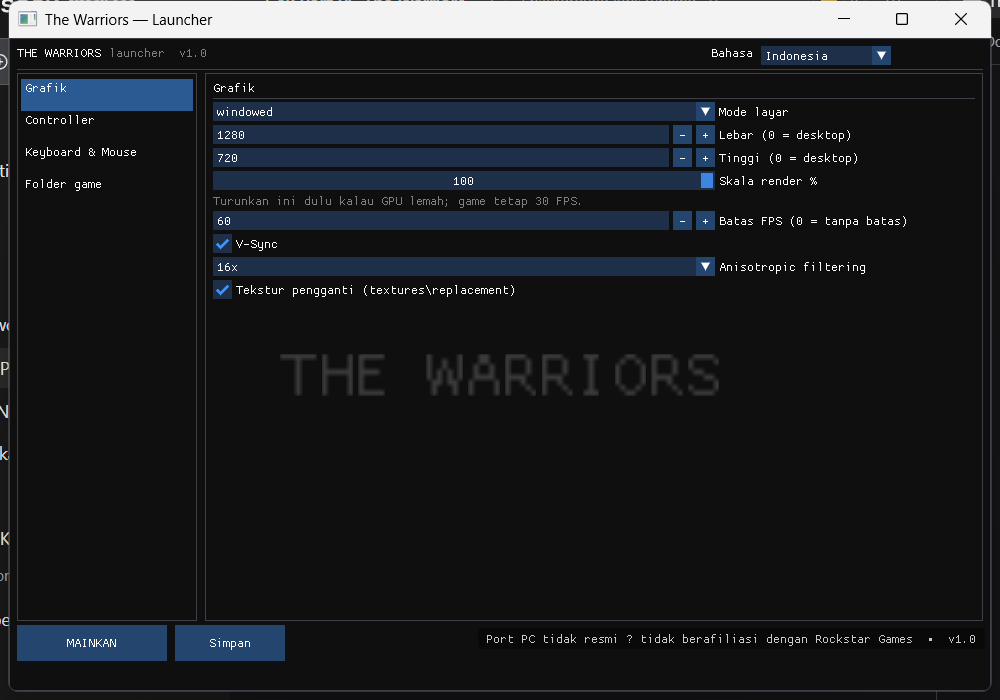

# The Warriors — native PC build (Xbox static recompilation)


[](https://github.com/irsyadkgr678/TheWarriors-XBE/releases/tag/v0.1.0-alpha)

An unofficial port of *The Warriors* (Xbox, 2005). The x86 code inside the game's `default.xbe` is translated to C++
at build time and linked against a Windows runtime: Direct3D 12 for rendering, XAudio2 for audio, SDL3 for window and
input. No emulator is involved at runtime.

> This repository contains no game code, no game data and no artwork. Building or running it requires your own
> legally owned NTSC/USA Xbox disc.

[Bahasa Indonesia →](README.id.md)



## Contents

- [What the port covers](#what-the-port-covers)
- [Status](#status)
- [Requirements](#requirements)
- [Playing a release build](#playing-a-release-build) (step-by-step: [tester guide](docs/INSTALL-FOR-TESTERS.md))
- [Launcher](#launcher)
- [Game data](#game-data)
- [Building from source](#building-from-source)
- [Controls](#controls)
- [Troubleshooting](#troubleshooting)
- [Repository layout](#repository-layout)
- [Implementation notes](#implementation-notes)
- [Legal](#legal)

## What the port covers

| Area | Implementation |
|---|---|
| Code translation | [XboxXBERecomp](https://github.com/TGP482/XboxXBERecomp) recompiler; 128 partitions generated from `default.xbe` |
| Rendering | Native Direct3D 12 backend; Xbox vertex programs, pixel combiners and fixed-function state are translated in the runtime |
| Audio | DirectSound implemented on XAudio2, including Xbox ADPCM, mix-in buffers and the 3D voice data XACT relies on |
| Input | SDL3 gamepads (Xbox, PlayStation, Switch, rumble) and a keyboard/mouse layer with rebindable keys |
| Front end | Separate launcher for graphics, controller, keyboard and game-folder settings; in-game panel on F10 |

## Status

Working:

- boots from `default.xbe` to the main menu and into gameplay
- Direct3D 12 rendering, including the game's own 720-style HUD layout at 640×480
- XACT audio: dialogue, music, 3D positional effects
- keyboard and mouse, including camera control, button prompts and the F10 panel
- gamepads through SDL3, with rumble

Not implemented:

- MSAA (the backend has no multisampled screen targets yet)
- 720p output; the game runs at its 480p mode
- System Link / online play (Winsock and XNet exports are still trapping stubs)

The port is alpha. It has been tested through the opening missions and a few minutes of gameplay. Later missions may
crash or show broken effects. Tested on a Ryzen 5 150 with integrated Radeon graphics: about 400 MB resident memory,
around 0.6 core while in the menu, 30 FPS internal (the game's own frame step).

## Requirements

| | Minimum | Recommended |
|---|---|---|
| OS | Windows 10 64-bit | Windows 11 64-bit |
| CPU | x86-64 with SSE4.2 and POPCNT (Intel Nehalem/Core 1st gen 2008+, AMD Bulldozer/FX 2011+), 2 cores | 4 threads or more |
| GPU | Direct3D 12 feature level 11_0 (NVIDIA GTX 600+, AMD HD 7000+, Intel HD 4200+) | discrete GPU from 2015 or later |
| VRAM | 256 MB | 512 MB or more |
| RAM | 2 GB | 4 GB or more |
| Disk | ~7 GB for the game data plus ~0.4 GB of build output | 12 GB |
| Input | keyboard and mouse | XInput/PlayStation/Switch gamepad |

Two cases that will not work:

- Core 2 Duo, Pentium Dual-Core and Phenom II. Those CPUs lack SSE4.2, and the build uses `-march=x86-64-v2`.
- GPUs with feature level 11_0 but no Direct3D 12 driver, such as Intel Ivy Bridge HD 4000. The launcher still opens
  (it uses Direct3D 11), so settings and the game folder can be configured, but the game cannot start.

## Playing a release build

A release archive contains the executables and the compiler, not the game. Latest download:
<https://github.com/irsyadkgr678/TheWarriors-XBE/releases/tag/v0.1.0-alpha>


```
TheWarriors/
  TheWarriorsLauncher.exe
  TheWarriors.exe
  TheWarriors.dll              created on first launch
  msvcp140.dll
  vcruntime140.dll
  vcruntime140_1.dll
  compiler/                    clang, lld and xbe_recomp, used on first launch
  assets/                      put your game here
```

1. Extract the archive to a writable folder. Avoid `C:\Program Files` and folders synced by OneDrive.
2. Put your game in `assets/`, in either form:
   - a single Xbox `.iso` (any filename), or
   - extracted files: `default.xbe`, `Main.wad0..3`, `Paks.wad0..2`, `System.wad0`, `XBoxWad.idx`, `audio/`, `bik/`.
3. Run `TheWarriorsLauncher.exe`. If the game is not in `assets/`, open the **Game files** tab and point it at the
   folder or ISO. Then press **Play**.
4. The first launch compiles the game's code from your `default.xbe`. It takes 1.5–4 minutes depending on the CPU and
   happens once per release. Later launches go straight to the game.
5. Press **F10** in game for display, mouse, key binding and controller settings.

A step-by-step version for first-time testers, including failure cases and what to attach in a report, is in
[docs/INSTALL-FOR-TESTERS.md](docs/INSTALL-FOR-TESTERS.md).

## Launcher

| Tab | Contents |
|---|---|
| Graphics | display mode, resolution, render scale, FPS cap, V-Sync, anisotropic filtering, replacement textures |
| Controller | camera speed, stick deadzone, invert X/Y, vibration strength, pad button remapping |
| Keyboard & Mouse | enable/disable, sensitivity, smoothing, invert Y, menu clicks, all 25 key bindings |
| Game files | data folder (any drive), game executable, location of `settings.toml` |

The interface is available in Indonesian and English. The launcher and the game read the same `settings.toml`, so
changes made in either place stay consistent.

## Game data

The runtime accepts one of two layouts and rejects the rest:

| Layout | Result |
|---|---|
| `assets/` contains one or more `.iso` files | mounted directly; `default.xbe` is read from the image |
| `assets/` holds the fully extracted disc (XBE, WADs, `audio/`, `bik/`) | read from disk |
| `assets/` holds only `default.xbe` without the WAD files | fails about 0.4 s after boot with `C0000005 write ... guest 00000000` |
| `.7z`, `.zip`, `.rar`, `.cso`, split images | not supported; extract or convert to a single `.iso` first |

The executable checks the SHA-1 of `default.xbe`. For this build it must be
`fe246a74501cd10d2ce89ca5dbda5080d2b2edcc` (title ID `0x5454009B`, XDK 5849). Other releases, including PAL/EUR,
produce a warning and will most likely crash. The PS2 and PSP versions are not compatible with this port.

The game folder can live anywhere. Set it in the launcher and it is stored as `game_files` in `settings.toml`; when
the field is empty the runtime looks for `assets/` next to the executable and in the folders above it.

## Building from source

Prerequisites:

- Visual Studio 2022 Build Tools with the C++ Clang tools, C++ CMake tools and the Windows 10/11 SDK
- Git, CMake 3.25 or newer, Ninja (portable copies work; `build-here.bat` adds `..\toolchain` to `PATH`)
- your own NTSC `default.xbe` placed at `assets/default.xbe`, with the game folders beside it

```bat
build-here.bat
```

The script configures CMake (which fetches Zydis, toml++, SDL3 and Dear ImGui), runs `xbe_symbols` to produce
`config/game.toml` from the XBE, recompiles 128 code partitions, then compiles and links.

Output in `out/build/release/`:

```
TheWarriors.exe             host runtime and hooks
TheWarriors.dll             recompiled game code (~15 MB)
TheWarriorsLauncher.exe     launcher
compiler/                   toolchain used to rebuild the game code on another machine
```

Notes:

- Configuration requires `assets/default.xbe`, because its hash is embedded in the executable. A checkout without a
  game dump cannot be built; that is inherent to recompilation projects.
- `xbe_symbols` resolves 179 of 243 functions and 10 of 12 data symbols for this XBE. The rest (Bink, some advanced
  DirectSound exports, Winsock/XNet) are either mapped by hand or left as trapping stubs.
- Release packaging: `package.bat` (no external tools) or `release.bat` (needs 7-Zip). Both exclude
  `TheWarriors.dll`, the game data and `compiler/work`.

## Controls

| Action | Keys |
|---|---|
| Move | W A S D, Left Alt to walk |
| Camera | mouse |
| Light attack (X) | left mouse |
| Heavy attack / charge (A) | right mouse, Enter |
| Grab / throw (B) | E, Backspace |
| Jump, climb, mug (Y) | Space |
| Sprint (LT) | Left Shift |
| Target / reverse grapple (RT) | Q |
| Block (Black) | F |
| White | R |
| Rage (both triggers) | Z |
| Gang commands (L3) | C |
| Right stick click | middle mouse, V |
| D-pad | arrow keys, 1 2 3 4 |
| Pause / Back | Esc, Tab |
| Settings panel | F10 |

All bindings can be changed in the launcher or in the F10 panel.

## Troubleshooting

| Symptom | Cause and fix |
|---|---|
| Exits immediately, fault in `MSVCP140.dll` | system CRT is older than the toolset. Release archives ship the matching runtime DLLs; keep them next to the executable. |
| `Put the game in the assets folder` | `assets/` is empty, the ISO is still archived, or the files sit one level too deep (`assets/The Warriors/default.xbe`). |
| `...is a different release of the game` | the XBE is not the NTSC retail release. PAL/EUR needs a different build. |
| Crashes about 0.4 s after boot | incomplete game folder, usually a lone `default.xbe`. Use the ISO or a full extraction. |
| First-launch compile fails | antivirus quarantined `compiler/clang.exe` or `lld-link.exe`. Restore them, add an exclusion; details in `logs/compile.log`. |
| Black screen or no window | update the GPU driver. On laptops with two GPUs, force the executable onto the discrete GPU. |
| No sound | set the intended playback device as the Windows default before starting. |
| Low frame rate | lower `render_percent` to 60–80, set `fps_cap` to 30, disable anisotropic filtering. |

Logs are written to `logs/TheWarriors.log`, saves to `hdd/`, settings to `settings.toml`, all next to the
executable. Crash dumps go to `CrashDumps/`.

## Repository layout

```
launcher/main.cpp        launcher: ImGui with a Direct3D 11 backend, writes settings.toml, starts the game
src/game/                game-side hooks: kbm, camera, prompts, menu, lockpick, movies, dsound, d3d
src/common/              apu_clock, game_info (host hook wiring)
config/game.toml         symbol map and hooks for this XBE
sdk/                     XboxXBERecomp (MIT) plus the fixes described below
docs/                    screenshots and historical notes
build.bat                full build
build-here.bat           build using the portable toolchain in ..\toolchain
package.bat              release archive without external tools
release.bat              release archive using 7-Zip
Play.bat                 opens the launcher, or the game if the launcher is missing
PORTING-STATUS.md        bring-up notes: what was fixed, why, and what is left
THIRD_PARTY.md           third-party components and licenses
```

## Implementation notes

The runtime is not stock. Fixes made for this title, all documented in [PORTING-STATUS.md](PORTING-STATUS.md):

- **APU sample counter.** XACT reads the MCPX counter at `0xFE80200C` directly. The host now commits that page and
  keeps a 48 kHz counter running; without it the game faults during audio init.
- **DirectSound.** The SDK's implementation was replaced with one that models XACT's requirements: mix-in buffers,
  3D voice data, amplitude envelopes, stream pause and flush behaviour.
- **Kernel waiters.** The upstream SDK's newer per-object waiter implementation caused the game to stall right after
  `D3D12 adapter`. The previous implementation from the port this project follows is used instead.
- **Memory accounting.** `MmQueryStatistics` no longer reports the kernel data area as available.

## Legal

The original work in this repository (launcher, build scripts, documentation, host-side fixes) is MIT licensed; see
[LICENSE](LICENSE). That license grants no rights to the game, its code or its assets.

*The Warriors* is © Rockstar Games / Take-Two Interactive. This project is unofficial, unaffiliated and ships no game
data. Third-party components and the origin of the game-side hooks are listed in [THIRD_PARTY.md](THIRD_PARTY.md).
